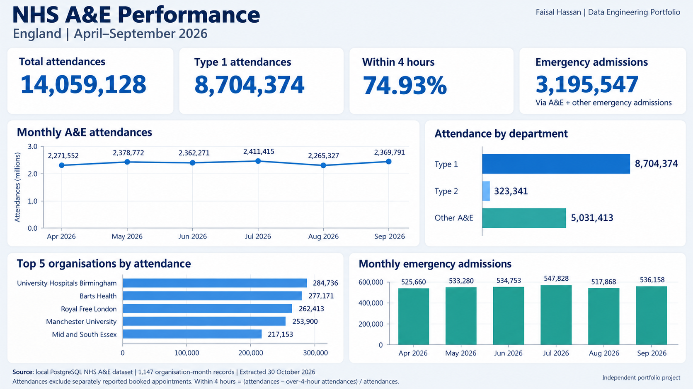
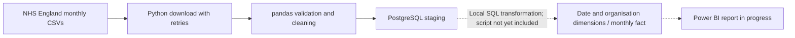

# NHS A&E Data Engineering Pipeline

An NHS England A&E data engineering portfolio project covering the workflow from public CSV publications to PostgreSQL analytics: automated file discovery, downloading, validation and cleaning in Python, a separate staging loader, and a local dimensional warehouse. The dashboard below visualises results calculated from that database.

**Status:** Python ingestion, cleaning and PostgreSQL staging loader implemented. Local warehouse populated; its schema is included. **Power BI report in progress.** Warehouse transformation scripts and scheduled execution are not yet included.

## Dashboard — actual database results



Static dashboard image generated from aggregate queries against the local PostgreSQL database; this is not a screenshot or export of the Power BI report. The Power BI implementation is separate and remains in progress.

| Metric | April–September 2026 |
| --- | ---: |
| Total A&E attendances | 14,059,128 |
| Type 1 attendances | 8,704,374 |
| Attendances within four hours | 74.93% |
| Emergency admissions, including other emergency admissions | 3,195,547 |
| Organisation-month records | 1,147 |

Attendance totals sum Type 1, Type 2 and Other A&E columns, excluding separately reported booked appointments. Within-four-hour percentage is `100 × (total attendances − attendances over four hours) / total attendances`, calculated from summed counts, not averaged percentages. Emergency admissions include admissions via A&E plus other emergency admissions.

Attendance totals (14,059,128), over-four-hour totals (3,524,694) and record counts matched staging and warehouse on 30 October 2026. No `TOTAL` organisation rows or null attendance/waiting fields were found in staging. These checks establish consistency of the local snapshot, not independent validation of the publisher's data. See [saved aggregate results](docs/dashboard-results.json) and [read-only SQL](sql/dashboard_metrics.sql).

## Automation and end-to-end workflow

1. **Discover and download:** Python finds monthly NHS CSV links, retries transient failures and skips files already downloaded.
2. **Validate and clean:** the same command profiles files, checks required columns and organisation codes, removes summary rows and writes cleaned CSVs.
3. **Load staging:** a separate Python command combines cleaned data and inserts records into PostgreSQL without duplicating existing keys.
4. **Model the warehouse:** the existing local database contains date and organisation dimensions and a monthly fact table. Its schema is committed; the population SQL is not yet included.
5. **Visualise:** the static image above uses database aggregates; the interactive Power BI report is being developed.

**Automation means processing runs automatically once the commands are launched.** There is no unattended schedule or single command covering the complete warehouse/report refresh. The project spans the end-to-end data workflow locally, with the reproducibility limits above.

## Architecture



## Implemented

- Discover monthly CSV links; download with retries, timeouts and temporary files.
- Validate required fields; profile missing values, duplicates and summary rows.
- Remove TOTAL summary rows case-insensitively, allowing surrounding whitespace; reject missing, blank or duplicate organisation codes.
- Combine cleaned files, validate the complete loader column set, and reject missing values or duplicate period/organisation keys.
- Insert into PostgreSQL using parameterised SQL and `ON CONFLICT (period, org_code) DO NOTHING` for repeat loads.
- Console and rotating file logs; synthetic-data and mocked-HTTP pytest tests.
- PostgreSQL date and organisation dimensions and monthly fact table, with primary and foreign keys.

## Verified local snapshot — 30 October 2026

The existing local database contains **1,147 staging records and 1,147 warehouse fact records**. These are organisation/month records, not patient attendances. The earlier Power BI import check also reported 1,147 records; the report remains in progress. Raw data and Power BI report files are not bundled; the static dashboard and aggregate results are included.

An older README recorded 1,150 cleaned rows before the summary-row cleaning update. That figure is superseded by the current database count; equal row counts alone do not establish full data correctness.

## Run locally

Verified with the existing Python 3.12 environment and PostgreSQL 17. Install dependencies in a virtual environment:

```bash
python3.12 -m venv .venv
source .venv/bin/activate
python -m pip install -r requirements.txt
python -m pytest -q
python -m src.pipeline
```

`src.pipeline` downloads and cleans only. It does **not** load PostgreSQL or refresh the warehouse. Alternatively, run individual stages:

```bash
python -m src.ingestion.download_ae
python -m src.ingestion.profile_ae
```

For a **new, empty database**, create the exported database structure and load staging:

```bash
createdb nhs_ae
psql -v ON_ERROR_STOP=1 -d nhs_ae -f sql/schema.sql
export PGDATABASE=nhs_ae
export PGHOST=localhost
# Set PGUSER for your local PostgreSQL role if needed.
# Use PostgreSQL's password prompt or ~/.pgpass for credentials.
python -m src.ingestion.load_postgres
```

The loader uses standard PostgreSQL connection environment variables. It does not read `.env` files automatically. Never commit credentials. `sql/schema.sql` is a schema-only PostgreSQL 17 export: apply once to an empty database, not to the existing populated database. It creates empty warehouse tables; **the SQL that populated the local warehouse has not yet been recovered into this repository**.

## Project layout

```text
config/settings.py              Project-relative directories
src/pipeline.py                 Download and clean entry point
src/ingestion/download_ae.py     Publication discovery and download
src/ingestion/profile_ae.py      Data quality and batch cleaning
src/ingestion/load_postgres.py   Validated staging load
src/utlis/                      Logging and exceptions
sql/schema.sql                  Staging and dimensional warehouse DDL
sql/validate.sql                Read-only record-count checks
tests/                         Synthetic and mocked tests
```

The original `utlis` spelling is retained for compatibility. Runtime data and log directories are created automatically and excluded from Git.

## Reruns, tests and limitations

Downloads skip existing files; cleaning overwrites outputs. The staging loader skips existing period/organisation keys, so revised publications need an explicit update strategy. No scheduling service is configured. Tests do not require NHS downloads or a running database and do not prove live-source availability or database end-to-end correctness. Fresh dependency installation has not been verified; tests use the existing local environment.

Publication discovery depends on link text. Numeric ranges and reporting-period consistency are not fully validated. Integer conversion in the loader assumes whole-number counts. Cleaned writes are not atomic. Organisation codes are normalised for validation but original values are retained. The historical warehouse population cannot yet be reproduced entirely from the committed scripts.

## Source and next steps

Source: [NHS England A&E Attendances and Emergency Admissions 2026–27](https://www.england.nhs.uk/statistics/statistical-work-areas/ae-waiting-times-and-activity/ae-attendances-and-emergency-admissions-2026-27/). Independent portfolio project, not affiliated with NHS England. Consult the publisher's terms before redistributing source data.

Next: capture warehouse transformation SQL, add database integration tests, complete Power BI KPIs and visuals, and implement scheduling. Azure, Databricks and dbt are **not implemented in this project**.
